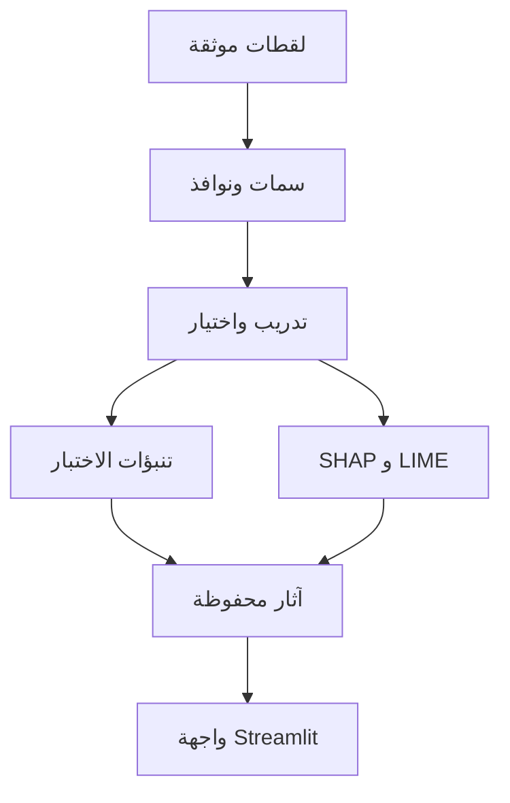
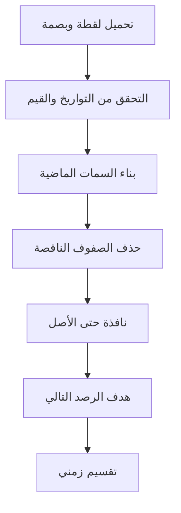
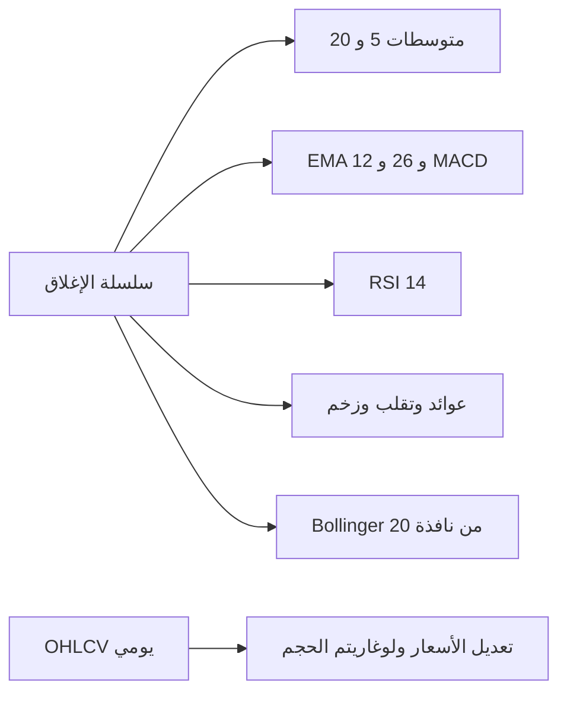
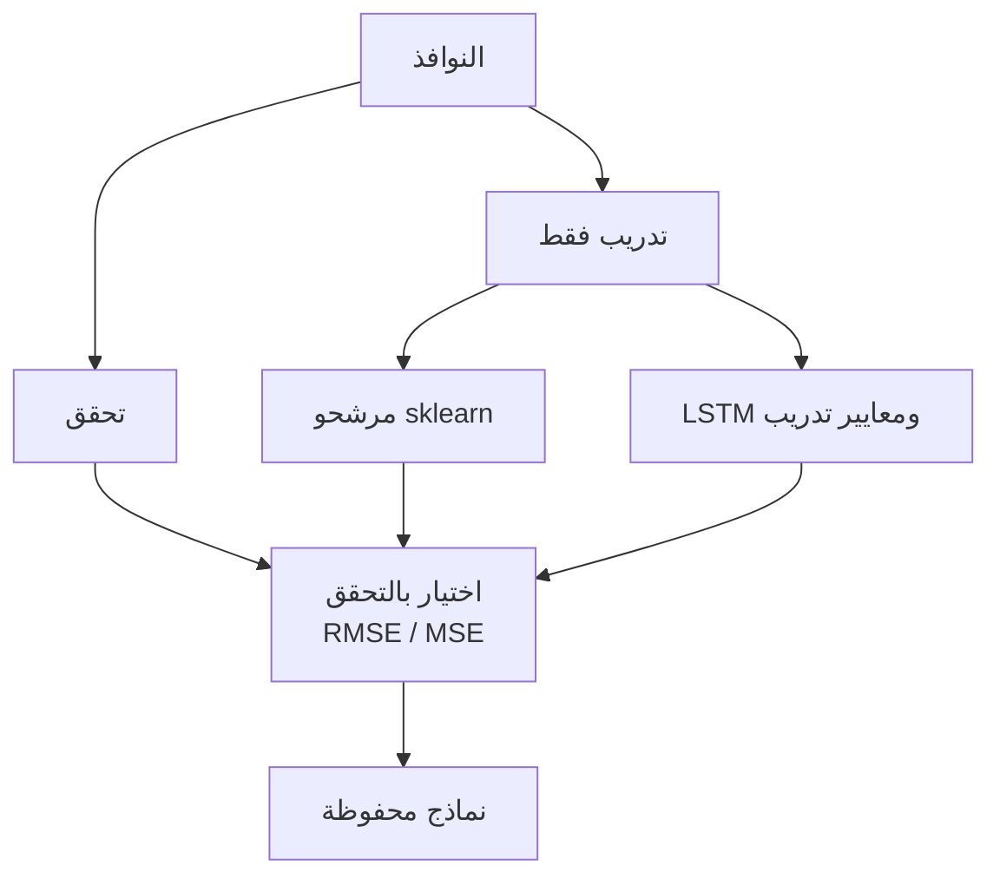
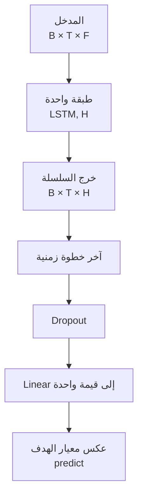
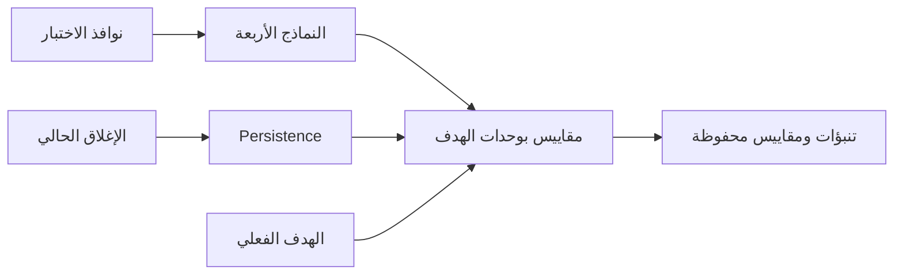
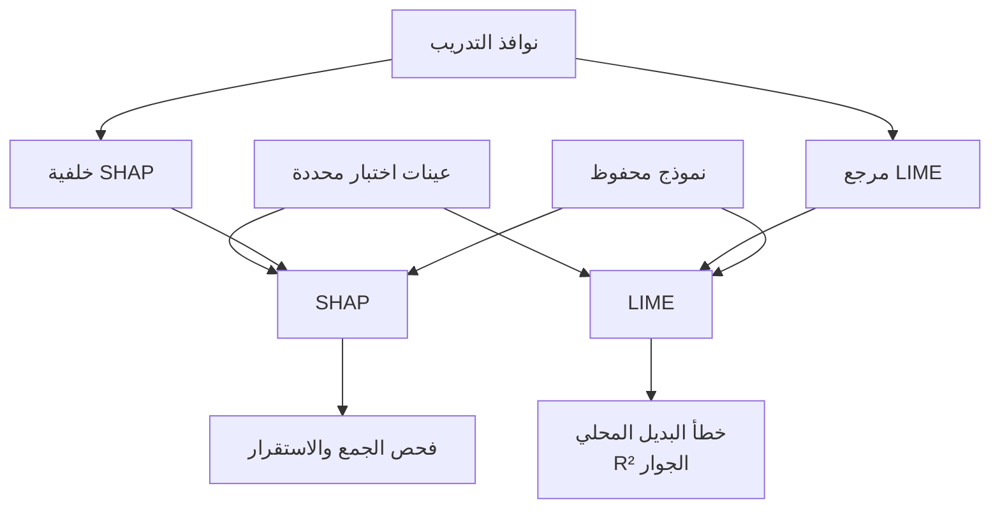
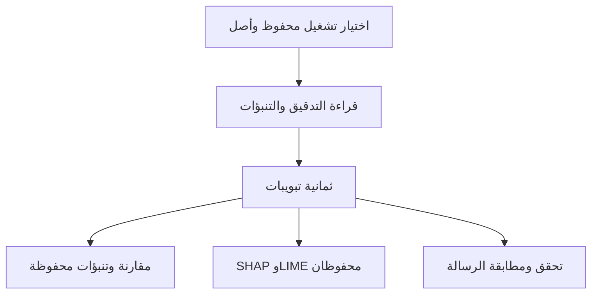
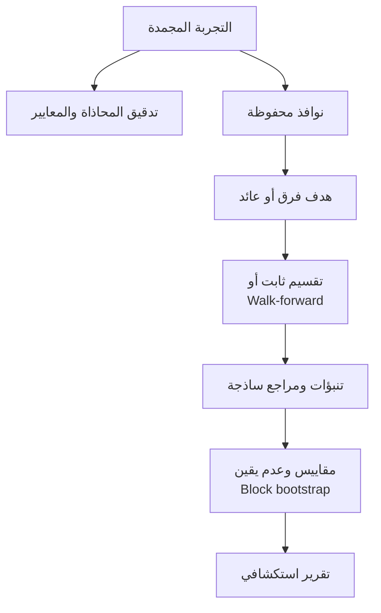
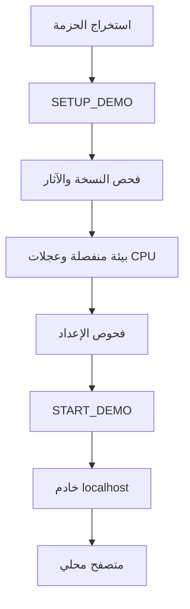

# مخططات بنية النظام ومساراته

هذه المخططات مستخلصة من الشيفرة المشار إليها أسفل كل رسم. نجح Mermaid CLI 11.4.2، المثبت في مجلد معزول للتوثيق، في تحليل الرسوم العشرة وتصديرها إلى SVG في `mermaid_rendered/`؛ بعض نسخ PNG الأقدم لا تعكس تعديلات تخطيط SVG الأخيرة. فُحصت المخططات العشرة بصرياً داخل نسخة PDF للمراجعة، وأعيد ترتيب بعض التسميات لتحسين قراءتها؛ تبقى المراجعة العلمية الشاملة لبقية الكتاب. نجاح التحليل لا يثبت صحة المخططات العلمية. الأسهم تلخص الاعتماد أو التسلسل ولا تعني تنفيذ كل خطوة عند عرض لوحة Streamlit.

## 1. البنية العامة

المصدر: `pipelines/train.py`, `pipelines/explain.py`, `dashboard/app.py`.

## 2. معالجة البيانات

المصدر: `io/data_sources.py`, `data/validate.py`, `data/features.py`, `data/windows.py`. الهدف هو الصف التالي بعد تكوين السمات؛ مطابقة الرصد الخام التالي في اللقطات المحفوظة موضوع تدقيق مستقل.

## 3. هندسة السمات

المصدر: `data/features.py`. تُطبق سمات OHLCV على التردد اليومي فقط.

## 4. التدريب

المصدر: `models/sklearn_models.py`, `models/lstm_model.py`, `pipelines/train.py`.

## 5. LSTM المنفذ

المصدر: `models/lstm_model.py:16–25,36–45`. لا تظهر الخلايا الداخلية كطبقات إضافية.

## 6. التنبؤ والتقييم

المصدر: `pipelines/train.py:89–107`, `evaluate/metrics.py`.

## 7. SHAP وLIME

المصدر: `pipelines/explain.py`, `explain/shap_explain.py`, `explain/lime_explain.py`.

## 8. Streamlit

المصدر: `dashboard/app.py:179–205`. لا يستدعي الرسم تدريباً أو inference حياً.

## 9. التحقق العلمي

المصدر: `validation/audit.py`, `validation/design.py`, `validation/experiments.py`, `validation/statistics.py`. هذه التجارب السابقة لا تُعاد في إعداد التوثيق.

## 10. النشر المحلي CPU

المصدر: `SETUP_DEMO.bat`, `START_DEMO.bat`, `scripts/demo_wizard.py`. التثبيت يعمل دون شبكة فقط عند توفر حزمة العجلات اللازمة؛ Python نفسه غير مرفق بحسب README.
