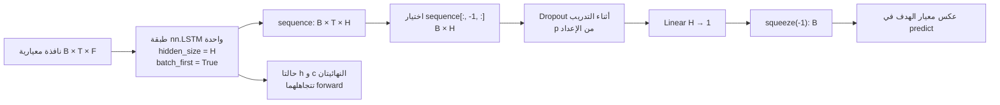

# شرح LSTM في المشروع

## دور النموذج ومدخلاته

يتعلم النموذج علاقة غير خطية بين نافذة سمات تاريخية والهدف التالي في السلسلة. لا يضمن استخدام الذاكرة تحسناً على Persistence أو استقراء ناجحاً خارج مستويات التدريب. ينشئ `build_windows` مصفوفة `(عدد العينات، طول النافذة، عدد السمات)`، ويقيّس `fit_training_scalers` المدخلات والهدف من التدريب فقط. في آثار AAPL المحفوظة الشكل `(2703, 30, 20)`؛ مع دفعة B يكون دخل `PriceLSTM` بالشكل `(B, 30, 20)`. إعداد التجربة الكاملة `hidden_size=32`، ومن ثم سلسلة الخرج `(B, 30, 32)`؛ تأخذ الشيفرة الخطوة الأخيرة `(B, 32)`، ويعيد الرأس الخطي `(B, 1)` ثم `squeeze(-1)` الشكل `(B,)` حتى مع B=1. السلسلة التاريخية كلها مستخدمة في حساب الخرج الأخير؛ لا يجمع الرأس مخرجات الخطوات جميعها مباشرة.

## معادلات الخلية وعلاقتها بالمكتبة

لم يكتب المشروع هذه البوابات يدوياً: يستدعي `PriceLSTM.__init__` في `src/xai_finance/models/lstm_model.py:19` طبقة `torch.nn.LSTM`. المعادلات التالية تصف خلية LSTM القياسية داخل PyTorch، حيث xₜ متجه السمات في الزمن t، وhₜ الحالة المخفية، وcₜ حالة الخلية، وσ sigmoid، و⊙ ضرب عنصري. أوزان W وU والتحيزات b معاملات تتعلمها الطبقة؛ ليست أرقاماً استخرجت من checkpoint:

- بوابة النسيان: `fₜ = σ(Wf xₜ + Uf hₜ₋₁ + bf)` تحدد نسبة الاحتفاظ من حالة الخلية السابقة.
- بوابة الإدخال: `iₜ = σ(Wi xₜ + Ui hₜ₋₁ + bi)` تتحكم في إضافة المعلومة.
- الحالة المرشحة: `gₜ = tanh(Wg xₜ + Ug hₜ₋₁ + bg)` تمثل المحتوى المرشح للإضافة.
- تحديث الخلية: `cₜ = fₜ ⊙ cₜ₋₁ + iₜ ⊙ gₜ` يجمع الاحتفاظ والتحديث.
- بوابة الإخراج: `oₜ = σ(Wo xₜ + Uo hₜ₋₁ + bo)`؛ الحالة المخفية `hₜ = oₜ ⊙ tanh(cₜ)` هي خرج الخطوة.

التحيز في المعادلات اختزال لمجموع تحيزي الإدخال والتكرار في PyTorch. لكل عينة بعد h وc يساوي hidden_size=32 في التكوين الكامل. لا تمرر `forward` حالة ابتدائية صريحة؛ تستعمل المكتبة حالاتها الافتراضية الصفرية لكل استدعاء، ولا تحمل حالة من دفعة لأخرى بهذه الشيفرة. بوابات sigmoid محدودة بين صفر وواحد، مما يتيح تدفقاً انتقائياً للمعلومة والتدرج، لكنه لا يزيل كل مشكلات التدرج.

## البنية المنفذة

الرسم يميز مخرج الطبقة sequence عن الحالة النهائية التي تتجاهلها الشيفرة. في `eval()` تتوقف إسقاطات Dropout العشوائية. لا توجد طبقة LSTM ثانية أو attention في `PriceLSTM`. يعرض فصل المعمارية الشكل المستخرج من المصدر؛ نجاح Mermaid في تفسير الصياغة لا يثبت صحة الاستنتاجات العلمية وحده.

## التدريب والاختيار والاستدلال

`fit_lstm` يختار الجهاز ويهيئ معايير التدريب والموترات والشبكة؛ `scaled_loss` تحسب متوسط `(ŷ_scaled−y_scaled)²`. في `train_epoch` تحسب `backward()` تفاضل الرسم عبر الخطوات الزمنية (BPTT) وفق مشتقات PyTorch؛ ثم يفك GradScaler المقياس قبل قص معيار التدرج عند 1، وينفذ Adam تحديث المعاملات. تختبر دقة AMP على عينة تدريب في وضع eval ودون تدرج؛ يرفضها الشرط إذا كانت خسارتها غير منتهية أو تجاوز الفرق النسبي المحسوب عن FP32 نسبة 5%. لا يفحص الشرط استقلالاً أن قيمة الفرق نفسها منتهية، ولا يثبت جودة كل التدرجات. على CPU الدقة FP32 وحجم الدفعة محدود بـ32؛ CUDA يجرب الأحجام ويختار أكبر حجم مقبول وفق قياس الذاكرة.

`optimize_epochs` يقيم خسارة التحقق دون تدرج في وضع eval بعد كل epoch، ويحفظ last وbest ويطبق early stopping حسب patience، ثم يعيد أوزان أدنى خسارة تحقق. لا يستخدم الاختبار للاختيار في هذا المسار. في الاستدلال يعيد `LSTMPredictor.predict` بناء النوافذ وتقييسها، ويستعمل no_grad ودفعات حتى 256، ثم يعكس تقييس الهدف. `load_lstm` يحمل أفضل checkpoint إلى الجهاز المطلوب عبر map_location مع scalers محملة منفصلاً.

## مثال نتيجة محفوظة وحدودها

يسجل `artifacts/runs/full_20261021T040901084647Z/AAPL/training.json` تدريب CUDA بدقة BF16، ودفعة 64، وأفضل epoch رقم 2 من 10 وخسارة تحقق معيارية `0.34953898191452026`. هذا وصف لذلك السجل، لا إعداد مضمون لكل تشغيل. ويسجل `AAPL/LSTM/metrics.json` لاختبار 271 رصداً RMSE قدره `61.414866257066755` وR² قدره `-4.637234640332287`. لم نعد حساب هذه النتائج هنا. ترتبط القيم بمجموعة وفترة ونموذج مدربين محددين؛ لا تُثبت سبباً وحيداً لتفوق أو ضعف النموذج.

راجع [الشرح السطري لـ LSTM](line_by_line/src_xai_finance_models_lstm_model.py.md) و[مسار التدريب](line_by_line/src_xai_finance_pipelines_train.py.md) للمواقع المحددة ومخارج الدوال وآثارها.
